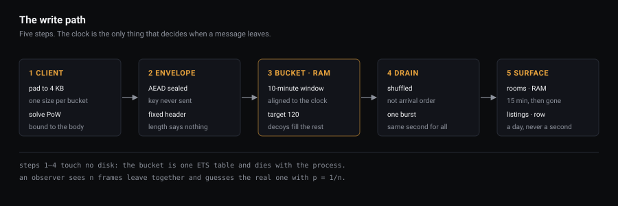
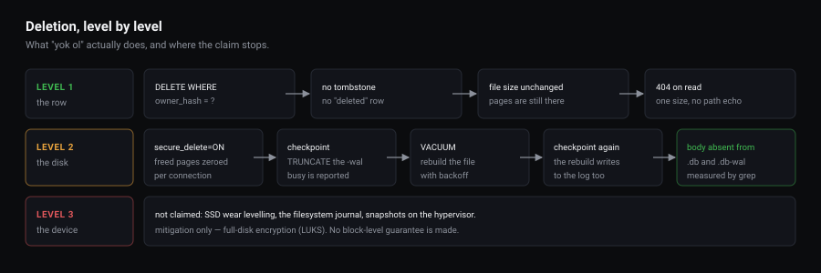
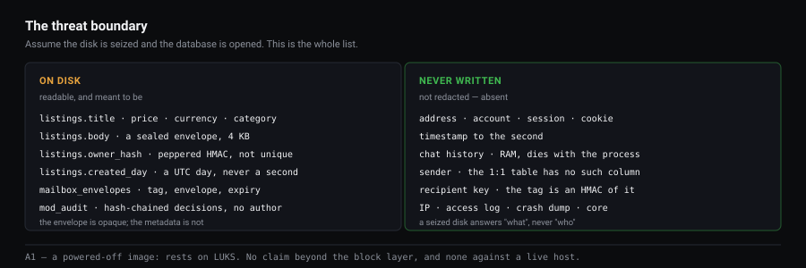

# zifiri

Self-hosted, three surfaces, no accounts — and a written record of exactly what it does
not hide.

> **zifiri** is a message board with no accounts. It keeps nothing that could tell you who
> wrote a line: no email, no session, no cookie, no author field, and the application never
> reads your IP address.
>
> What it does not hide: on a clearnet instance the network path in front of the app
> (nginx, the kernel, the host) can still see your IP, and the operator can recognise the
> server's own decoy traffic, so there is no anonymity claim against the operator. Run it
> as a Tor onion service and the server never sees an IP at all. Each claim and the command
> that checks it: [claims.md](docs/claims.md).



## What this is not

- **Not a place to point at people.** No personal data about third parties, no
  targeting, no doxxing. That is a product rule, enforced in moderation — not a moral
  lecture on the homepage.
- **Not a leak archive.** There is no dump, no mirror, no "post it here instead".
- **Not a social network.** No follows, no likes, no profiles, no public history.
- **Not a marketplace.** Listings are text; payment, escrow and shipping happen
  elsewhere, at the users' own risk.
- **Not an app.** Web only, works in a phone browser, no install.

## The three surfaces

| Surface | What it is | Where it lives |
|---|---|---|
| **Rooms** | one public room, a 500-message ring buffer, 15-minute retention, 12 bits of work per message | RAM only — no table, no file, no log line; a restart is a wipe |
| **Messages** | one-to-one, 4096 B sealed envelopes, addressed by a 16-byte HMAC tag | `mailbox_envelopes`, 72-hour TTL, no sender column to store |
| **Listings** | classifieds with plaintext metadata and a sealed body | `listings`, a UTC day and never a second, non-unique `owner_hash` |

## Claims

Every claim has an ID. `docs/claims.md` is the registry, `docs/verify.md` carries one
heading per ID with the command that can refute it, and the two ID sets are kept
identical by a one-line diff rather than by prose. Counts below are single-file
`mix test` runs on **2026-11-23**.

| ID | Claim | Test | Result |
|---|---|---|---|
| C-01 | A bucket is ten minutes, target 120, aligned to the wall clock | `test/bucket_test.exs` | 14 passed |
| C-02 | The bucket drains on the clock, not on a count; the drain is shuffled | `test/bucket_test.exs` | 14 passed |
| C-03 | An empty bucket is completed with decoys; `fill(n)` = `n − real` | `test/decoy_test.exs` | 15 passed |
| C-04 | A decoy is indistinguishable from a real envelope — 4096 B, valid signature | `test/decoy_shape_test.exs` | 6 passed |
| C-05 | The real message's position inside the bucket is uniform | `test/timing_test.exs` | 3 passed |
| C-06 | The decoy key is per bucket, in RAM, never on disk | `test/decoy_test.exs` | 15 passed |
| C-08 | The 1:1 table has five columns; no sender, conversation or account column | `test/mailbox_test.exs` | 30 passed |
| C-09 | 1:1 addressing is a 16-byte HMAC tag; the key is never stored | `test/mailbox_test.exs` | 30 passed |
| C-10 | A 1:1 envelope is exactly 4096 B, enforced by the table as well | `test/mailbox_test.exs` | 30 passed |
| C-11 | 1:1 TTL is 72 hours and the sweeper deletes what expired | `test/mailbox_test.exs` | 30 passed |
| C-12 | 1:1 paging: 200 upper bound, a cursor that neither skips nor repeats | `test/mailbox_test.exs` | 30 passed |
| C-15 | Listings: plaintext metadata, non-unique `owner_hash`, day precision, escaped `LIKE` | `test/listings_test.exs` | 33 passed |
| C-16 | Presence: no trace when off, `:unknown`, mutual for five minutes, ETS only | `test/presence_test.exs` | 31 passed |
| C-17 | Deletion level 1: the row goes, no tombstone, the file is untouched | `test/vanish_test.exs` | 33 passed |
| C-18 | Deletion level 2: the body is in neither the `.db` nor the `-wal` | `test/vanish_test.exs` | 33 passed |
| C-19 | Schema allowlist: no table outside the list | `test/schema_test.exs` | 8 passed |
| C-20 | No logs at code level: no `Logger.info`, no `IO.inspect`, no `dbg` | `test/no_log_test.exs`, `test/architecture_test.exs` | 9 + 6 passed |
| C-22 | The envelope is padded to 4 KB; its size does not vary with the input | `test/envelope_test.exs` | 22 passed |
| C-23 | `owner_hash` is a peppered HMAC, not an identity, and not unique | `test/owner_test.exs` | 18 passed |
| C-24 | IP and peer never reach the application; `X-Forwarded-For` is stripped | `test/transport_test.exs` | 2 passed |
| C-25 | PoW: the challenge is single-use and bound to the envelope | `test/pow_test.exs` | 22 passed |
| C-26 | Chat writes nothing to disk; the room stream lives in RAM | `test/chat_test.exs` | 31 passed |
| C-27 | Fixed-size error responses; the path is never echoed back | `test/leak_test.exs` | 9 passed |

Twenty-three of the forty-nine rows are above — the ones a reader can check with a single
command. The rest (unproven claims, deployment-level checks, text audits, and the four that
are honestly still red) are in [`docs/claims.md`](docs/claims.md).



## Quick start

```bash
make check                 # mix format --check-formatted, compile --warnings-as-errors, mix test
mix phx.server             # http://127.0.0.1:4000
cd client && npm ci && npm test
cd client && npm run size  # bundle budget
```

Numbers from the last full run on this checkout, **2026-11-23 08:13**:

| Suite | Command | Result |
|---|---|---|
| ExUnit | `mix test` | **383 passed**, 0 failures, 5.4 s |
| Client | `cd client && npx vitest run` | **292 passed, 5 failed** of 297 (2 files) |
| Bundle | `cd client && npm run size` | **14.5 KiB gzip** of a 100 KiB budget (14.5%), 33.5 KiB raw JS |

The 5 client failures are one drift, not five bugs: `client/src/ui/mode.ts` defaults to
`fast` (scope v5 decision, claim C-30) while `dm-view.test.ts` and `rooms-view.test.ts`
still assert the old `silent` default and the copy that went with it.
`mix format --check-formatted` also currently flags `test/api_test.exs`. Both are reported
here rather than rounded off.

## Limits

- **No claim against A1.** A powered-off disk image is the operator's problem, and full-disk
  encryption (LUKS) is the only thing that reduces it. zifiri makes no claim past the block
  layer.
- **No claim against a live host.** Memory, a core dump, an SSD's wear-levelling and the
  filesystem journal are outside the model.
- **If the content describes itself, there is no solution.** Padding hides length, a bucket
  hides timing, a decoy hides the real message — none of them survive a post that names its
  own author, its own street, or its own only-employer. That is a writing problem, and the
  honest answer is that the tool cannot fix it.
- **Fast mode is not anonymous.** It is a 1-in-5 neighbourhood, not 1-in-120; the UI says
  so before the first send.
- **Deletion stops at level 2.** `docs/claims.md` row C-39 is red and C-40 is unproven:
  VACUUM still runs on the delete path and `auto_vacuum` is not configured. The decision is
  recorded, the code has not caught up, and the doc says so.



## Decisions

Why each of these is the way it is — including the ones that were reversed — lives in
[`docs/DECISIONS.md`](docs/DECISIONS.md). The measurement record behind every claim is in
[`docs/claims.md`](docs/claims.md); the runnable side is [`docs/verify.md`](docs/verify.md).

## Credits

Built by **c1tymorgu3** — [c1tymorgu3.com](https://c1tymorgu3.com).

## License

AGPL-3.0. See [LICENSE](LICENSE).
