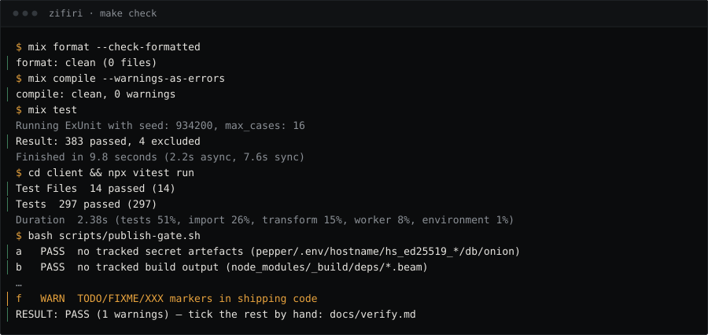
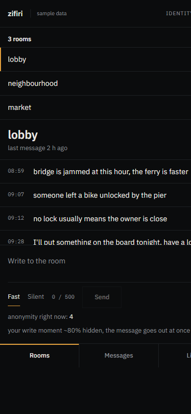
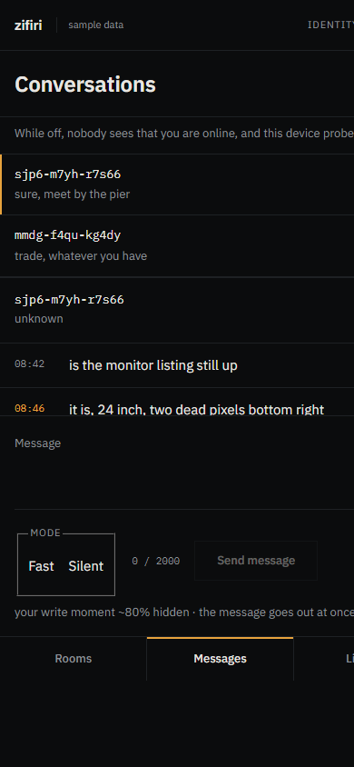
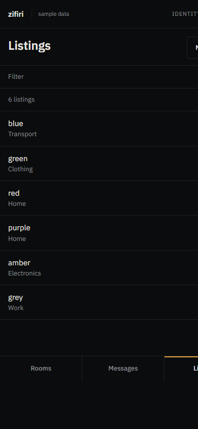
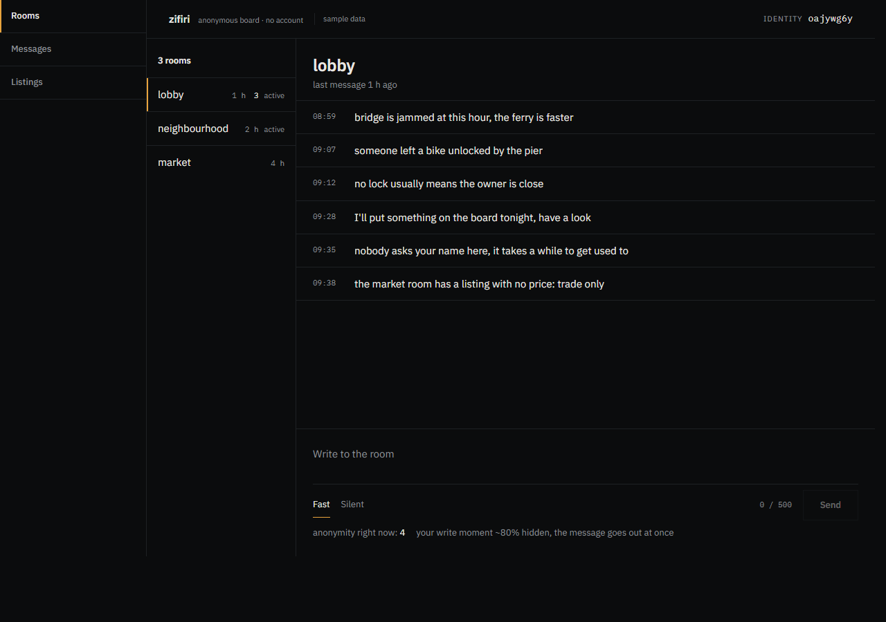
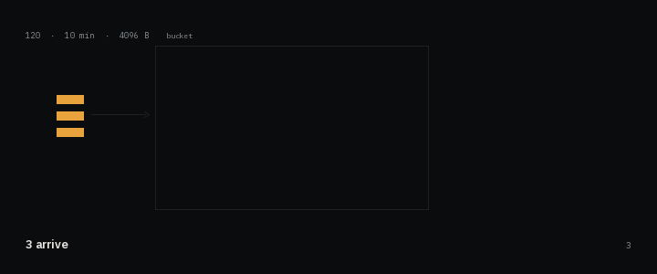
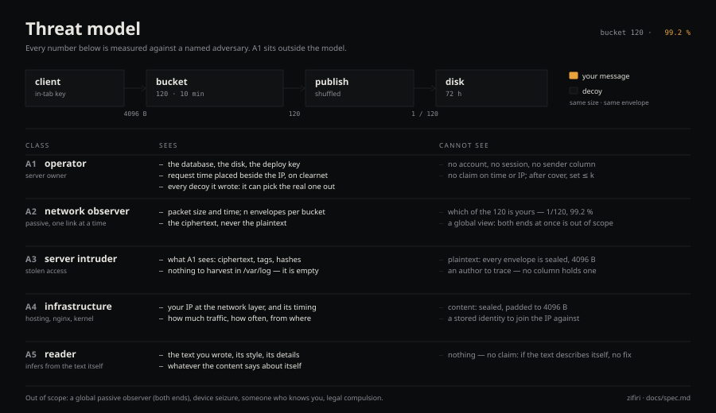

<p align="center">
  
</p>

<p align="center">
  <a href="https://github.com/c1tymorgu3/zifiri/actions/workflows/ci.yml"></a>
  
  
  
  
  
  
  
</p>

<h1 align="center">zifiri</h1>

<p align="center">A message board where the database cannot answer "who wrote this".</p>

---

No account, no session, no cookie, no author column. You generate a key in the browser, post,
and the server keeps a row with no path back to you.

That is a claim about the database, not about the wire. On clearnet an operator can still put a
request time next to an address; the model starts where they do, and the section below says so
in the same words the threat model uses.

There are two ways to send, and the faster one is the default.

**Fast** leaves immediately. The only cover is whoever else wrote in the last minute, and the
button prints that number: with no traffic it reads 1, which is the honest answer, because the
observer then has one candidate.

**Secret send** trades latency for a set, and today it does that for the room only. The message
joins a ten-minute bucket, the bucket fills with decoys to exactly 120 entries, and the whole
thing is shuffled before anyone reads it, so an observer has 120 candidates and no way to tell
which one you wrote. One-to-one mail still writes straight to its table: C-14 says the bucket
should cover it, and C-14 is not proven.

Every claim below carries an ID, and every ID has a command that can refute it. If a claim
cannot be checked, it does not belong in this file.

<p align="center">
  
</p>

## Where to start

| You are | Read | Then |
|---|---|---|
| **Someone who might use it** | the three surfaces below | open an instance, post once |
| **Someone who might run it** | [docs/spec.md](docs/spec.md) | `infra/` — one VPS, one compose file, one SQLite file |
| **Someone who wants to break it** | [docs/claims.md](docs/claims.md) | [docs/verify.md](docs/verify.md) — one command per claim |

<details>
<summary><b>Table of contents</b></summary>

- [What it looks like](#what-it-looks-like)
- [Three surfaces](#three-surfaces)
- [How a write travels](#how-a-write-travels)
- [What it does not hide](#what-it-does-not-hide)
- [Claims](#claims) and [check one yourself](#check-one-yourself)
- [Why it is built this way](#why-it-is-built-this-way)
- [Compared to](#compared-to)
- [Questions](#questions)
- [Architecture](#architecture)
- [Documentation](#documentation)

</details>

## What it looks like

<p align="center">
  
  
  
  
</p>

<p align="center"><sub>Rooms, Messages and Listings on a phone, next to the same room on a desktop. Sample data.</sub></p>

## Three surfaces

| Surface | What it is | Where it lives |
|---|---|---|
| **Rooms** | one public room, 500-message ring buffer, 15-minute retention | RAM only. No table, no file, no log line. Restart is a wipe |
| **Messages** | one-to-one, 4096-byte sealed envelopes, addressed by a 16-byte tag derived from the writer's seed | `mailbox_envelopes`, 72-hour TTL, no sender column exists |
| **Listings** | classifieds with plaintext title, price and category, and a padded body | `listings`, UTC day, non-unique `owner_hash` |

## How a write travels

The diagram is secret send in the room. Fast skips the bucket, and so does one-to-one mail today.

<p align="center">
  
</p>

```
browser                    server                      disk
───────                    ──────                      ────
pad to bucket   ──────►    decode + verify padding     nothing yet
solve PoW       ──────►    redeem single-use challenge
                           enqueue in 10-min bucket
                           at the boundary: fill to 120 with decoys,
                           shuffle, publish the whole bucket
                                                       listings / mailbox rows
```

The exchange is a challenge the server issued, bound to one body and one owner. It is spent on
first use, so one solved nonce buys one write, not a season of them. Difficulty is 17 bits by
default and rises with queue depth; the number comes from a measurement, not an estimate.

Deletion is the other half, and it is the expensive part. Erasing runs a checkpoint, then
`VACUUM`, then a second checkpoint: the first checkpoint pushes the delete into the file,
`secure_delete` has already zeroed the cell, and `VACUUM` rebuilds the file so it stops carrying
the size and shape of what was removed. A file that stays exactly as large as the post you
deleted has not forgotten it.

That rewrite is why an erase is not free. Fifty listings measured 8 to 12 ms with nothing else
running; under concurrent load it has not been measured, and the honest sentence is that a
`VACUUM` waits for readers and retries three times before it gives up. A sweeper picks up what a
request could not finish, so an erase that answers `ok` really is done, and one that could not
finish says so. There are no tombstones and no backups: a backup is a copy you cannot delete.

## What it does not hide

<p align="center">
  
</p>

- On clearnet, the path in front of the application sees your IP. Run the onion service and it
  does not.
- An operator can recognise decoy traffic their own server generated. The design assumes they
  comply and minimises what compliance yields: ciphertext and a list of hashes.
- Content that describes its author defeats every design in this repository. No amount of
  padding fixes a sentence that says where you work.

## Claims

Forty-nine claims live in [docs/claims.md](docs/claims.md), each with a test, a threshold and a
status. [docs/verify.md](docs/verify.md) carries the command, and CI diffs the two ID sets so
they cannot drift apart. As of 2026-11-23: **34 green, 11 unproven, 1 flaky**, and 3 that say what is *not*
claimed, which is how 49 rows add up. The file says so row by row.

The table below is not the flattering subset. It carries the three system-level claims that are
still unproven, because those are the ones a reader should weigh before trusting the rest.

| ID | Claim | Status |
|---|---|---|
| C-01 | A bucket is ten minutes, target 120, aligned to the wall clock | Green |
| C-03 | An empty bucket is filled with 120 decoys | Green |
| C-04 | A decoy is indistinguishable from a real envelope: 4096 B, same header and padding | Green |
| C-08 | The one-to-one table has no sender, conversation or account column | Green |
| C-18 | Erase: `secure_delete`, WAL truncate, `VACUUM`; the body is in neither file | Green |
| C-20 | No body-bearing log: one redacted `Logger.error` in the sweeper, Ecto logging off, no `IO.inspect` | Green |
| C-24 | `X-Forwarded-For` and `X-Real-IP` are stripped before the application | Green |
| C-25 | The proof-of-work challenge is single-use and bound to the envelope | Green |
| C-26 | Chat writes nothing to disk; the room stream lives in RAM | Green |
| C-32 | The application does not read IP, XFF or user agent | Green |
| C-14 | One-to-one envelopes also enter the bucket and are completed to 120 | **Unproven**: today they write straight to the table |
| C-21 | Deployment logs: proxy `access_log off`, container logging off, no core dumps, no swap | **Unproven**: configuration written, never drill-tested |
| C-36 | On onion the server cannot see the client address | **Unproven**: the onion drill has not been run on a live host |
| C-47 | `mailbox_id` is derived from the seed by HKDF | Green |

### Check one yourself

```bash
make check                      # 383 backend tests, 0 failures
make client                     # 297 client tests, then the bundle size check
bash scripts/publish-gate.sh    # no secret, no placeholder, no TODO in the tree
bash scripts/e2e/run.sh         # a real Chrome posts, reads and deletes against a live server
```

If any of those is not green on your machine, the claim it covers is not true for you. That is
the point of writing them this way.

## Why it is built this way

Three decisions that shaped everything else, each with the alternative we threw away.

**Buckets of 120, not a k-anonymity pool.** The first design collected five writers and
published them together. It was a counter, not a set: five is not an anonymity set, and the
product sat locked until the fifth stranger arrived. A ten-minute bucket filled with decoys
gives 120 candidates whether one person posts or twenty. 120 is where the set is worth
something: 1 − 1/120 is 99.2%, which is arithmetic, not a measurement.

**SQLite, not Postgres.** Postgres writes faster and replicates, and it keeps deleted tuples
until vacuum, keeps a WAL you archive, and keeps `pg_log` on by default. Every one of those is a
place where the row you deleted still exists. The write profile here is bursty by design: the
bucket collects for ten minutes and publishes once, so the single-writer limit never binds. p95 is
50 ms at 200 concurrent writers.

**`secure_delete` and a WAL truncate, not `VACUUM`.** Vacuum rewrites the whole file, which
means it stalls every writer for as long as it runs, and it cannot be the thing a two-click
delete depends on. Zeroing freed pages and truncating the WAL happens in milliseconds and holds
under load. Vacuum still runs at night; it is maintenance, not the guarantee.

## Compared to

| | Account needed | Who you talked to | Delete means | Logs by default | Self-host |
|---|---|---|---|---|---|
| **zifiri** | none | no sender column exists | rows gone, pages zeroed, WAL truncated | none | yes, one SQLite file |
| **Signal** | phone number | sealed sender; no directory of who talks to whom | messages expire on the device | minimal | no, server is not published |
| **Matrix** | account on a homeserver | the homeserver sees sender and room | redaction, not erasure | homeserver keeps room state | yes |
| **Tor forum** | often a handle | Tor hides your IP; the post still carries a handle and a time | moderator removes the post | usually yes | yes |
| **A classic board** | account | full metadata, IP included | admin deletes the row, backups remain | yes | yes |

<sub>Signal from its published sealed-sender spec, Matrix from the client-server spec, the
classic board from stock phpBB defaults. Read their docs before quoting this table.</sub>

## Questions

<details>
<summary><b>Is this Tor?</b></summary>

No. It runs on clearnet and on an onion service at the same time. On clearnet the application
never sees your IP, but nginx and the kernel do, so the claim narrows to "no identity". On
onion, there is no IP to see. The claim follows the mode you are in.
</details>

<details>
<summary><b>What happens if someone compels the operator?</b></summary>

They get ciphertext, a list of HMAC'd owner hashes, and a bucket that says "120 arrived". There
is no table that maps a row to a person because that table was never written. The operator's own
anonymity is not part of the model. That is their problem to solve, and the design does not
pretend otherwise.
</details>

<details>
<summary><b>Can I run one for my town?</b></summary>

Yes. One VPS, one compose file, one SQLite file on a LUKS volume. `infra/` has the nginx config,
the Dockerfile, systemd units and a hardening script. There is no separate database process to
keep alive and nothing to scale horizontally until you are past tens of thousands of writes a
day.
</details>

<details>
<summary><b>Why 120?</b></summary>

Because the anonymity set is the product. 32 entries gives 96.9%, 120 gives 99.2%, 1000 gives
99.9% — and 1000 entries every ten minutes is about 576 MB of cover traffic a day per room. 120 is the
point where the guarantee is real and the bill is still small. The arithmetic is in
[docs/spec.md](docs/spec.md).
</details>

<details>
<summary><b>Where do I lose my identity?</b></summary>

In the 71-character string the browser generates on first load. It is never sent anywhere, and
it is the only thing that can delete what you wrote. Lose it and the rows stay until their TTL,
uneditable by you. That is a documented consequence, not a support ticket.
</details>

<details>
<summary><b>Can an operator tell a decoy from a real message?</b></summary>

Yes, and the threat model says so. Decoy bodies are generated server-side, so the operator knows
which rows they wrote. The claim is not "indistinguishable to the operator"; it is
"indistinguishable to anyone watching the wire, the disk, or a stolen backup": same size, same
entropy, same publish instant.
</details>

## Architecture

```
Phoenix endpoint ── unix socket ── nginx (access_log off, headers stripped)
      │
      ├─ Pow.Challenge   single-use, body and owner bound
      ├─ Envelope        four buckets, zero padding, no length leak
      ├─ Bucket         10 minutes, decoy fill, shuffle at the boundary
      ├─ Chat.Store     RAM ring buffer, 500 messages, 15 minutes
      ├─ Mailbox        sealed envelopes, HKDF tag, 72-hour TTL
      ├─ Listings       classifieds, owner token, no seller record
      └─ Vanish         delete, secure_delete, checkpoint, night vacuum
               │
            SQLite (one file, one writer, LUKS underneath)
```

<details>
<summary><b>Repository map</b></summary>

```
lib/zifiri/      33 modules, 6.2k lines
test/            383 tests, 7.3k lines against 6.2k of source
client/          vanilla TypeScript, no framework, 297 tests
infra/           nginx, Dockerfile, compose, onion, systemd units, harden.sh
scripts/         drills, measurements, e2e, publish gate
docs/            spec, claims, verify, measurements, decisions
```

</details>

## Documentation

- [docs/spec.md](docs/spec.md) the specification: surfaces, threat model, mechanisms
- [docs/claims.md](docs/claims.md) every claim, its test, its threshold
- [docs/verify.md](docs/verify.md) the command that refutes each claim
- [docs/measurements.md](docs/measurements.md) measured numbers with the scripts that produced them
- [docs/decisions.md](docs/decisions.md) what changed and why, in one page
- [CONTRIBUTING.md](CONTRIBUTING.md) how to run CI locally, and the two questions every patch answers

## License and credits

AGPL-3.0. If you run a modified version as a service, publish the source.

Built by [c1tymorgu3](https://c1tymorgu3.com).
